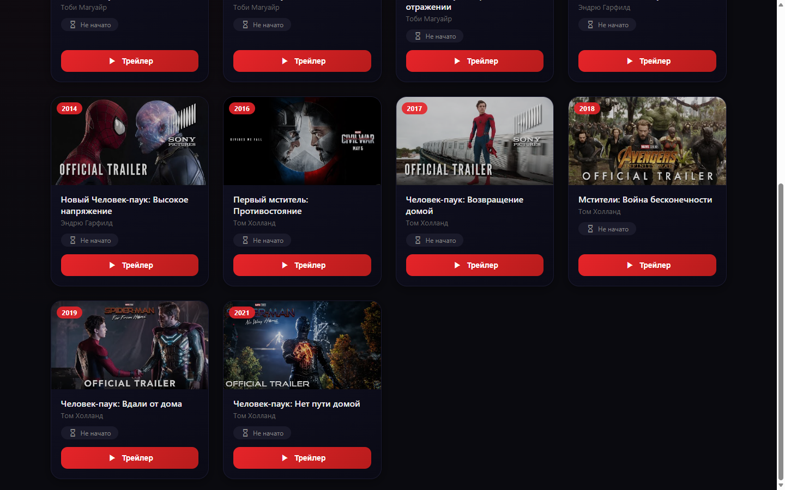

# Spider-Man Кинотека

> Movie watch-tracker: sign up, watch official trailers, keep "where I stopped" per film. Node.js + Express sessions.



Все фильмы про Человека-паука по порядку. Регистрируешься, смотришь трейлер, отмечаешь статус («не начато / в процессе / просмотрено») и время, где остановился. Прогресс у каждого юзера свой и хранится на сервере.

## Что внутри

- регистрация и вход, сессии на `express-session` (httpOnly cookie)
- пароли хранятся как `scrypt`-хеш с солью, сравнение через `timingSafeEqual`
- простой антибрут: 10 попыток в минуту с IP
- валидация всего, что приходит в API (логин, статус, id фильма)
- каждый видит только свой прогресс
- плеер на `youtube-nocookie.com`: YouTube не ставит куки, пока не нажмёшь play
- в демо только официальные трейлеры с каналов Sony Pictures и Marvel

## API

| метод | путь | что делает |
|---|---|---|
| POST | `/register` | регистрация `{login, password}` |
| POST | `/login` | вход |
| POST | `/logout` | выход |
| GET | `/session` | кто залогинен |
| GET | `/progress` | мой прогресс |
| POST | `/progress` | сохранить `{movieId, status, timestamp}` |

## Запуск

```bash
npm install
npm start                      # http://localhost:3000
# для прода задай секрет сессий:
SESSION_SECRET=длинная_случайная_строка npm start
```

Данные лежат в `data/` (JSON-файлы, в гит не попадают).

---
Сделано [Quorvox_team](https://github.com/Quorvox)
